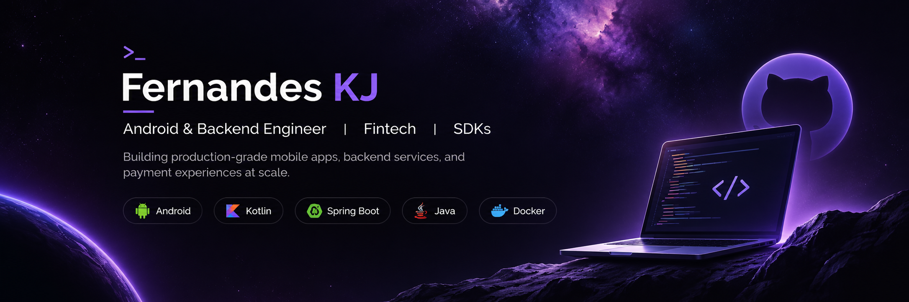
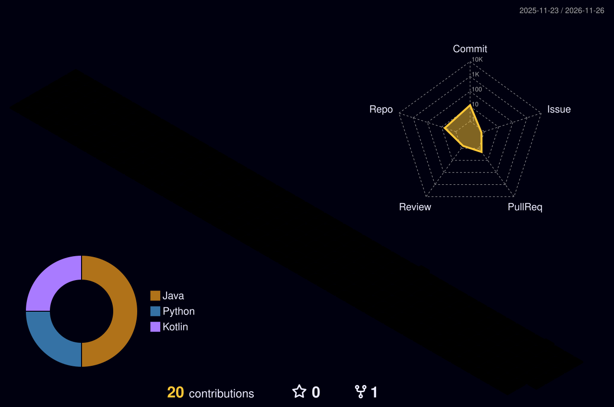
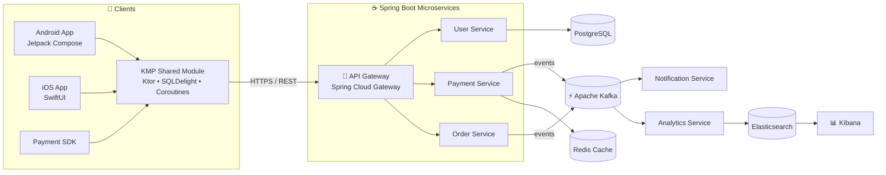

<!-- ═══════════════════════════ BANNER ═══════════════════════════ -->
<p align="center">
  
</p>

<p align="center">
  <a href="https://git.io/typing-svg">
    
  </a>
</p>

<p align="center">
  <a href="https://fernandes-kj.vercel.app/"></a>
  <a href="https://linkedin.com/in/fernandes7"></a>
  <a href="https://medium.com/@fernooxplozd"></a>
  <a href="https://twitter.com/fernandesk31701"></a>
  
</p>


## 🧑‍💻 About Me

I'm a **Software Development Engineer** with **3+ years** of experience engineering **production-level Android applications** and **scalable backend systems**.
I build **high-throughput services** with **Spring Boot** and **Kafka**, alongside resilient **Kotlin / Jetpack Compose** apps and **payment SDKs** used in production.
Passionate about **clean architecture**, **system reliability**, and **developer-friendly tooling**. 🚀

```kotlin
data class Engineer(
    val name: String = "Fernandes K J",
    val alias: String = "Ferno",
    val experience: String = "3+ years",
    val location: String = "Kerala, India 🇮🇳",
    val mobile: List<String> = listOf("Kotlin", "Jetpack Compose", "KMP", "Payment SDKs"),
    val backend: List<String> = listOf("Spring Boot", "Microservices", "Kafka", "Event Streaming"),
    val currentlyBuilding: List<String> = listOf("Design Architectures", "AI Agent Simulations"),
    val currentlyLearning: List<String> = listOf("Spring Boot Microservices", "KMP + Native UI (Android & iOS)"),
    val funFact: String = "Fun talks, travelling & outings with strangers 🌍",
) {
    fun sayHi() = println("Thanks for dropping by! Let's build something scalable together 🤝")
}
```

## ⚡ What I Do

<table>
<tr>
<td width="50%" valign="top">

### 📱 Mobile Engineering
- 🤖 Native Android apps with **Kotlin + Jetpack Compose**
- 🌐 Shared logic with **Kotlin Multiplatform**, native UI on Android & iOS
- 💳 Production-grade **payment SDKs**: secure, lightweight, backward compatible
- 🏛️ **MVVM / MVI + Clean Architecture**, modular codebases
- ⚙️ Coroutines, Flow, Hilt/Koin, Room, Retrofit/Ktor, WorkManager

</td>
<td width="50%" valign="top">

### 🖥️ Backend Engineering
- ☕ High-throughput services with **Spring Boot**
- 🧩 **Microservices**: discovery, API gateway, config server
- ⚡ **Event-driven architectures** with **Apache Kafka**
- 🗄️ PostgreSQL, Redis, MongoDB, Cassandra, Elasticsearch
- 🐳 Docker, Kubernetes, Jenkins, Prometheus / Grafana / Kibana

</td>
</tr>
</table>


## 🛠️ Tech Stack

<p align="center"></p>
<p align="center"></p>
<p align="center"></p>
<p align="center"></p>
<p align="center"></p>


## 🌌 3D Contributions

<p align="center">
  <picture>
    <source media="(prefers-color-scheme: dark)" srcset="./profile-3d-contrib/profile-night-rainbow.svg" />
    <source media="(prefers-color-scheme: light)" srcset="./profile-3d-contrib/profile-season-animate.svg" />
    
  </picture>
</p>

## 📊 GitHub Metrics

<p align="center">
  
  
</p>

<p align="center">
  
  
</p>

<p align="center">
  <a href="https://github.com/ryo-ma/github-profile-trophy">
    
  </a>
</p>


## 🏗️ How I Build Systems



## 🎯 Current Focus

| | |
|---|---|
| 🔭 **Working on** | Design Architectures & AI Agent Simulations |
| 🌱 **Learning** | Spring Boot Microservices · Kotlin Multiplatform with Native UI (Android & iOS) |
| 👯 **Collaborate on** | Scalable Backend Services |
| 🤝 **Looking for help with** | Senior Backend Service Architectures · Senior Android Development |
| 💬 **Ask me about** | Production-ready Android SDKs · Backend Event Streaming |
| ⚡ **Fun fact** | Fun talks, travelling & outings with strangers 🌍 |

<p align="center">
  <a href="https://fernandes-kj.vercel.app/"></a>
  <a href="https://docs.google.com/document/d/16f_jTiv7U8rtYBwqTWQqN4flk5QJu3ZoyB-Koo9fIUI/edit?usp=sharing"></a>
</p>

## ✍️ Latest Blog Posts

<!-- BLOG-POST-LIST:START -->
<!-- BLOG-POST-LIST:END -->

<a href="https://medium.com/@fernooxplozd"></a>

## 🐍 Contribution Snake

<p align="center">
  <picture>
    <source media="(prefers-color-scheme: dark)" srcset="https://raw.githubusercontent.com/Fernandes7/Fernandes7/output/github-snake-dark.svg" />
    <source media="(prefers-color-scheme: light)" srcset="https://raw.githubusercontent.com/Fernandes7/Fernandes7/output/github-snake.svg" />
    
  </picture>
</p>

## 🤝 Connect With Me

<p align="center">
  <a href="https://linkedin.com/in/fernandes7"></a>
  <a href="mailto:fernandeskj007@gmail.com"></a>
  <a href="https://twitter.com/fernandesk31701"></a>
  <a href="https://medium.com/@fernooxplozd"></a>
  <a href="https://dev.to/fernandes7"></a>
  <a href="https://leetcode.com/u/fernandes007/"></a>
  <a href="https://instagram.com/ferno_oxplozd"></a>
  <a href="https://buymeacoffee.com/fernandeskj"></a>
</p>

<p align="center">
  
</p>
